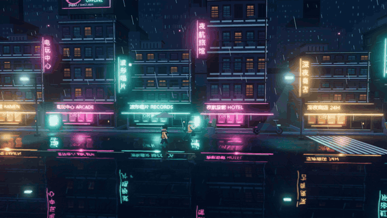
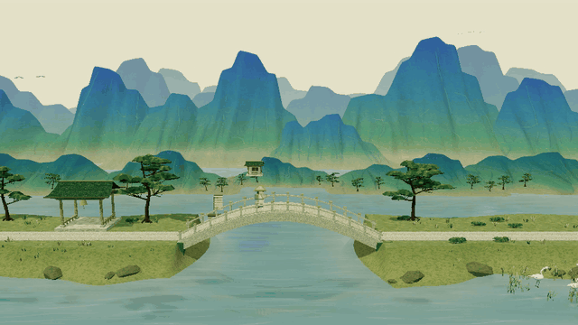

# HD2D Skill

**像素三维场景搭建 · Pixel art in 3D spaces**

中文 | [English](README.en.md)

一个中文场景制作 skill：用简单三维几何建立空间，以像素素材、镜头和光影塑造观感。适用于游戏、互动插画、空间导览及展示，不限定题材、引擎或平台。

包含两份可离线运行的 HTML demo：**雨港 · 霓虹夜行**与**千里江山 · 画中游**。

## 动态预览

### 雨港 · 霓虹夜行



像素角色、方盒建筑、透视跟随、霓虹辉光与踩水反馈。[下载后体验雨港](assets/demos/雨港.html)。

### 千里江山 · 画中游



青绿山水、亭桥草木、人物移动、水面映色与远近层次。[下载后体验千里江山](assets/demos/千里江山.html)。

## 快速使用

1. 下载并解压仓库或分享包，将文件夹命名为 `hd2d-scene-builder`。
2. 将整个文件夹放入支持 `SKILL.md` 的智能体工具的技能目录。Codex 使用 `$CODEX_HOME/skills/`；未设置 `CODEX_HOME` 时使用 `~/.codex/skills/`。
3. 在新会话中使用 `$hd2d-scene-builder`，补充主题、镜头、平台和需要的交互。其他工具的安装与调用方式以其技能机制为准。

例如：

> 使用 $hd2d-scene-builder 制作一个竖屏古风庭院，使用透视镜头，人物可以沿石径行走。

> 使用 $hd2d-scene-builder 优化现有像素三维场景中的移动闪烁，保留像素风格。

也可直接阅读 [制作入口](SKILL.md)，了解完整搭建流程。

## 体验样例

解压后用支持 WebGL 2 的浏览器打开：

| Demo | 内容 | 文件 |
| --- | --- | --- |
| 雨港 | 透视街景、像素角色、霓虹光影、湿地反射与踩水反馈 | [雨港.html](assets/demos/雨港.html) |
| 千里江山 | 青绿山水、亭桥草木、水岸倒影、晨暮切换与景物互动 | [千里江山.html](assets/demos/千里江山.html) |

程序、样式、图片与声音资源已内嵌，不依赖 CDN 或素材服务。浏览器需要启用硬件加速，声音需要点击按钮开启。完整操作见 [demo 说明](assets/demos/README.md)。GitHub 的文件预览显示源码；请先下载文件再用浏览器打开。

## 内容导航

- [SKILL.md](SKILL.md)：范围判断、灰盒、模块化、镜头、交互与交付流程。
- [像素素材](references/pixel-art.md)：绘制顺序、像素密度、平铺、角色动作、锚点、图集与采样。
- [光影与稳定性](references/lighting-stability.md)：照明层次、移动闪烁诊断、辉光与抗锯齿取舍。
- [水面与交互](references/water.md)：反射方案、波纹限频、触水事件与资源预算。

## 校验与重新打包

需要 Python 3.10 或更新版本，仅使用标准库。在仓库根目录运行：

```text
python tools/release.py check
python tools/release.py pack
```

生成的 `dist/hd2d-scene-builder.zip` 包含 skill、参考文档、中英文说明、两份 demo 与预览动图，可直接分享。

## 许可

本仓库自有文档、代码与样例中的自有内容采用 [MIT 许可证](LICENSE)。第三方内容继续遵循各自许可，详见 [第三方声明](THIRD_PARTY_NOTICES.md)。
